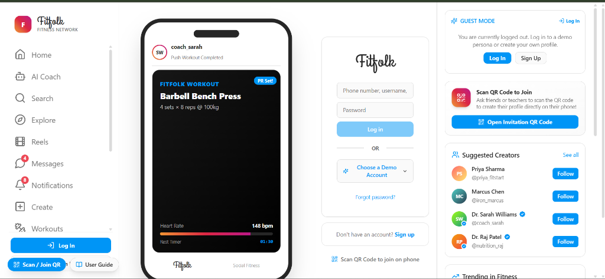
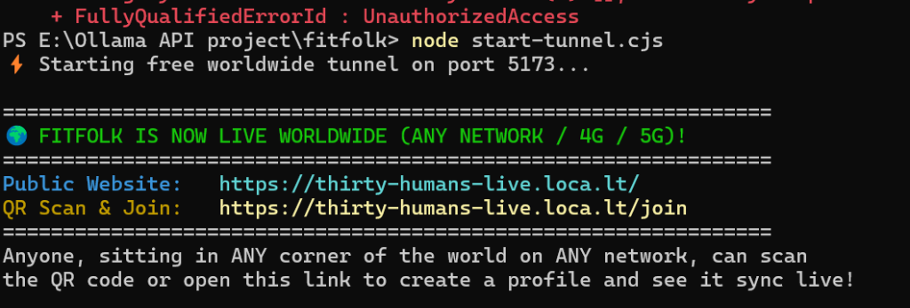
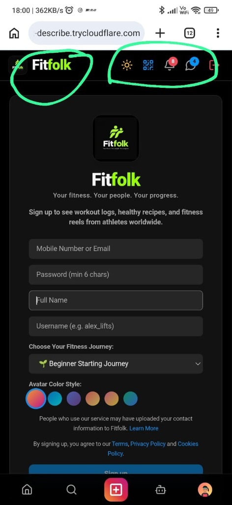

# FitFolk — Social Fitness Platform & AI Coach

FitFolk is a social fitness application designed to combine social media engagement with workout logging, nutrition management, and personalized guidance.

---

## Highlights & Features

- **Social Activity Feed:** Share workout updates, training media, progress stories, and community polls.
- **Workout Engine & Exercise Catalog:** Built-in exercises, customizable sets, reps, weight logs, and rest intervals.
- **Nutrition & Hydration Tracker:** Daily macronutrient balancing, calorie targets, and hydration logs.
- **Community Q&A & Trainer Profiles:** Evidence-backed health discussions with verified coach badges.
- **Challenges & Streaks:** Milestone challenges with active streak progress.
- **Interactive AI Coach:** Intelligent fitness assistant providing tailored tips and routine guidance.
- **Responsive Theme Engine:** Support for dark and light modes across mobile, tablet, and desktop viewports.

---

## App Previews

| Home Feed | Post Experience | Mobile Onboarding |
|:---:|:---:|:---:|
|  |  |  |

---

## Architecture & Technology Stack

- **Frontend Core:** React 18 with TypeScript
- **Styling:** Tailwind CSS with custom theme variables
- **Build System:** Vite
- **Routing:** React Router (SPA)
- **Icons:** Lucide React
- **Client Persistence:** Local browser storage layer with versioning and fallback recovery
- **Cloud Deployment:** Pre-configured for zero-configuration deployment on Vercel

---

## Project Structure

```text
fitfolk/
├── docs/
│   ├── FitFolk-Presentation.pptx  # 10-Slide Project Presentation Deck
│   └── screenshots/               # Application Showcase Screenshots
├── public/
│   ├── assets/                    # Static Assets & Default Avatars
│   ├── _redirects                 # SPA Redirect Rule
│   └── favicon.svg                # Application Favicon
├── src/
│   ├── app/                       # Application Root, Providers & Router
│   ├── components/                # Modular UI Components (Layout, Feed, Auth)
│   ├── data/                      # Initial Seed Data & Mock Datasets
│   ├── features/                  # Feature Pages (Feed, Workouts, Nutrition, AI Coach)
│   ├── hooks/                     # Custom Utility Hooks
│   ├── lib/                       # Device Auth, Ollama API & Storage Services
│   ├── styles/                    # Global Styles & Tailwind Rules
│   ├── types/                     # TypeScript Type Definitions
│   └── main.tsx                   # Entry Point
├── package.json
├── tailwind.config.js
├── tsconfig.json
├── vercel.json                    # Vercel Deployment & Rewrite Config
└── vite.config.ts
```

---

## Getting Started

### Prerequisites

- Node.js (v18 or newer)
- npm or yarn

### Installation & Local Run

1. Clone this repository:
   ```bash
   git clone https://github.com/SanchitNexus/FitFolk.git
   cd FitFolk
   ```

2. Install dependencies:
   ```bash
   npm install
   ```

3. Launch development server:
   ```bash
   npm run dev
   ```

4. Build for production:
   ```bash
   npm run build
   ```

---

## Project Presentation Deck

The repository includes a 10-slide architectural and investor presentation located at:
`docs/FitFolk-Presentation.pptx`

It details the product architecture, tech stack, data models, and feature roadmap.
